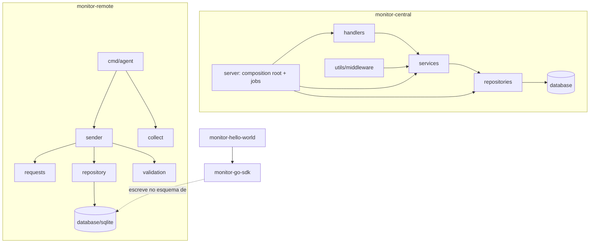

# Plano de melhoria arquitetural — Monitor (perspetiva ADS)

> **Âmbito:** `monitor-central`, `monitor-remote`, `monitor-go-sdk`, `monitor-hello-world`.
> **Base teórica:** slides de ADS (ISCTE, 01 a 06): QA, tácticas, padrões, GoF, utility tree, ADD.
> **Contexto:** projeto proposto pela equipa (2 pessoas). O mesmo sistema é avaliado em **EUVI**
> (UI/UX) e em **ADS** (arquitetura). Os repos vão ficar públicos.
> **Prioridades da equipa para ADS:** (1) métricas de qualidade, (2) escalabilidade, (3) manutenção,
> e todas as decisões justificadas e defendidas.
> **Prazo:** 9 de dezembro de 2026 (3 semanas a partir de 18/11). **Relatório:** LaTeX detalhado, no
> formato do relatório `mqtt-secure` (§13). **EUVI** mexe no frontend a partir da 1.ª semana de dezembro,
> possivelmente só depois da entrega de ADS.
> **Baseline técnica (18/11/2026):** build, vet e gofmt limpos; testes unitários verdes; 16/16 testes de
> integração verdes depois da correção `db.Exec`. Cobertura unitária: central 25,8%, remote 68,0%,
> hello-world 56,8%, SDK 0%.

---

## Índice

0. Como ler
1. Objetivos de negócio
2. **Priorização dos atributos de qualidade: porquê estes e não outros**
3. Utility tree e cenários de QA
4. **Métricas de qualidade e ferramentas**
5. Arquitetura atual (as-is)
6. Lacunas encontradas
7. Decisões (ADR)
8. **Plano de evolução para 10.000+ hosts (backlog com gatilhos)**
9. Decisões rejeitadas
10. Fronteira ADS / EUVI
11. Âmbito para 9/12 e calendário
12. Pontos por esclarecer
13. Estrutura do relatório (LaTeX)

---

## 0. Como ler

O plano segue o processo dos slides 06: **objetivos → ASRs → utility tree → tácticas e padrões →
iterações ADD → *generate and test***. Cada decisão (§7) tem uma ficha ao estilo ADR com:
**Problema** (e evidência no código), **Decisão**, **Teoria** (táctica ou padrão dos slides), **Alternativas
rejeitadas**, **Trade-offs** e **Verificação** (que cenário ou métrica a prova).

Os números dos cenários são **propostas da equipa**: não há enunciado. Cada um vem acompanhado da
justificação de onde veio, sobretudo das estimativas *back-of-the-envelope* (slide 04).

---

## 1. Objetivos de negócio

| # | Objetivo | Porquê |
|---|---|---|
| G1 | **Nenhuma telemetria se perde**, mesmo com o central em baixo | Um monitor que perde dados durante um incidente falha exatamente quando é preciso |
| G2 | O operador sabe depressa quando um host ou uma app tem problemas | É a razão de existir do produto |
| G3 | **Crescer de dezenas para milhares de hosts** sem reescrever o sistema | Prioridade definida pela equipa |
| G4 | **Manter e evoluir com custo controlado**: 2 pessoas, 2 cadeiras, código partilhado | Prioridade definida pela equipa; o código muda por razões de ADS e de EUVI ao mesmo tempo |
| G5 | Seguro por omissão | Os repos vão ser públicos e a API de ingestão fica exposta na rede |
| G6 | Integrar uma app nova custa pouco | SDK mínimo, sem credenciais |

---

## 2. Priorização dos atributos de qualidade: porquê estes e não outros

Os slides 02 e 03 dizem: *"QA can not be achieved in isolation, one has effect (positive/negative) on
the achievement of others… determining the design is partially a matter of making the appropriate
tradeoffs."* Esta secção torna esses trade-offs explícitos.

### 2.1 Ranking

| Rank | QA | Prioridade | Justificação |
|---|---|---|---|
| 1 | **Scalability** | Alta | G3. Escolha explícita da equipa. É também o QA com **maior impacto arquitetural**: mudar de 1 para N instâncias, ou de tabelas simples para particionadas, é caro de fazer tarde (slide 02: *"the earlier a problem is detected in design the cheaper"*). |
| 2 | **Modifiability / Maintainability** | Alta | G4. *"Most of the cost of SW occurs after initial release"* (slide 03). Neste projeto há duas cadeiras a mudar o mesmo código, por isso a mudança é **garantida** e não apenas provável. |
| 3 | **Availability** (com integridade dos dados) | Alta | G1/G2. Num sistema de monitorização é um **requisito de domínio**: um monitor indisponível ou que perde dados não tem valor. Já está quase toda implementada, por isso aqui o trabalho é **provar** e **não regredir** ao escalar. |
| 4 | **Testability** | Alta (habilitador) | Não é um objetivo em si: é o que permite mudar (2) e escalar (1) sem regressões. A baseline mostrou o risco: os testes de integração estavam partidos e ninguém sabia. |
| 5 | **Monitorability** | Média-Alta | Sem medir, não se demonstra escalabilidade. Também é exigência do domínio: o monitor tem de mostrar as próprias perdas. |
| 6 | **Security** | Média | O *baseline* já é forte (HMAC, CSRF, bcrypt, auditoria). Com os repos públicos e a API exposta, sobe de Baixa para Média, mas o sistema não guarda dados pessoais sensíveis nem pagamentos. Avaliamos por **checklist** (slide 04) em vez de lhe dar prioridade de desenho. |
| 7 | **Performance** | Média, **subordinada à escalabilidade** | A telemetria é assíncrona: um operador não espera 50 ms vs 200 ms numa ingestão. Interessa o **throughput sob carga crescente**, que medimos como escalabilidade, e a latência do dashboard. Por isso a performance não aparece como QA independente com prioridade alta. |
| 8 | **Interoperability** | Baixa-Média | Há um único agente (Go). O contrato fica documentado para permitir agentes futuros, mas não desenhamos para *service discovery* nem para múltiplos protocolos. |
| 9 | **Usability** | **Baixa em ADS** | Não é irrelevante: é tratada **em EUVI**. Em ADS limitamo-nos ao suporte arquitetural (separação MVC que permite a EUVI mudar a UI sem tocar no domínio, e dados disponíveis para *Maintain System Model*). Evita trabalho duplicado entre cadeiras (§10). |

### 2.2 Trade-offs explícitos e como os resolvemos

| Conflito | Escolha | Táctica que mitiga o lado que perde |
|---|---|---|
| **Scalability vs Modifiability**: mais instâncias, partições e coordenação trazem mais complexidade | Escalar **só até onde as medições exigem** (1.000 hosts). O resto fica em backlog com gatilhos (§8) | *Defer Binding* (papéis por configuração), *Encapsulate* (o particionamento fica escondido atrás do repositório) |
| **Availability vs Consistency**: entrega at-least-once pode duplicar | At-least-once + **deduplicação idempotente** (recibos por `host_id, source_id`) | *Transactions* (dados + recibo na mesma transação) |
| **Scalability vs Availability**: controlo de admissão (`RESOURCE_EXHAUSTED`) rejeita pedidos | Rejeitar **sem perder**: o remote guarda e volta a tentar depois do `RetryInfo` | *Limit Event Response* no central + *Retry* no remote |
| **Modifiability vs Performance**: estratégias por métrica vs uma query set-based | Manter **uma só query set-based**, montada a partir das estratégias (D13) | *Increase Cohesion* sem *N+1 queries* |
| **Security vs Performance**: HMAC por pedido, bcrypt no login | Aceitar o custo: HMAC custa µs; o bcrypt só corre no login | — |
| **Security vs Modifiability da UI (EUVI)**: uma CSP restritiva pode partir scripts inline | CSP primeiro em **Report-Only**, depois *enforce* de forma coordenada | *Change Default Settings* faseado |
| **Testability vs Simplicity**: interfaces e *clock* injetado acrescentam indireção | Interfaces **pequenas, definidas por quem as consome** (idioma Go) | *Abstract Data Sources*, *Limit Nondeterminism* |

---

## 3. Utility tree e cenários de QA

Escala (slide 06): **(valor de negócio, impacto arquitetural)**. Cenários no formato de 6 partes do
slide 02 (Fonte, Estímulo, Artefacto, Ambiente, Resposta, Medida). Os mais importantes estão por
extenso em 3.2.

### 3.1 Árvore

```
Utility
├── Scalability
│   ├── Crescimento de hosts
│   │   ├── SC1 (H,H) 1.000 hosts em regime normal → ingestão sem erros, p95 <300 ms, CPU do central <70%
│   │   └── SC2 (H,H) Central volta após 1 h em baixo com 1.000 hosts → backlog absorvido ≤15 min, dashboard p95 <1 s durante a recuperação
│   ├── Escala horizontal
│   │   └── SC3 (H,H) 2.ª e 3.ª instância do central → throughput ≥1,8× / ≥2,5×; jobs nunca correm em duplicado
│   ├── Crescimento de dados
│   │   └── SC4 (H,M) 30 dias de dados de 1.000 hosts → query do dashboard p95 <1 s; retenção sem degradar a ingestão
│   └── Volume de logs imprevisível
│       ├── SC5 (H,H) 1% dos hosts em rajada (200 logs/s) → os restantes mantêm lag p95 <5 s; o host ruidoso é rejeitado por sobrecarga (`RESOURCE_EXHAUSTED`)
│       └── AV4 (H,M) Rajada de logs com o central em baixo → o buffer do host nunca passa o limite configurado; perdas só de INFO/WARN, contadas e reportadas
├── Modifiability
│   ├── MO1 (H,H) Nova métrica de alerta → ≤1 pessoa-dia, ≤3 ficheiros Go + 1 migração
│   ├── MO2 (H,M) Alterar uma regra do protocolo → 1 sítio por repo; divergência detetada por teste de contrato
│   └── MO3 (H,M) EUVI muda a apresentação de uma página → 0 alterações em services/repositories
├── Availability
│   ├── AV1 (H,H) Central em baixo 1 h → 0 registos perdidos, 0 duplicados
│   ├── AV2 (H,M) Host deixa de responder → offline + alerta em ≤ timeout + 60 s, **mesmo com 1.000 hosts**
│   └── AV3 (M,M) 4xx transitório ou chave corrigida → entrega retoma ≤5 min sem reiniciar o remote
├── Testability
│   ├── TE1 (H,M) Push/PR → CI (lint, unit, integração, vulns) ≤10 min; falha bloqueia o merge
│   ├── TE2 (M,M) Handlers testáveis com fakes; cobertura de handlers ≥60%
│   └── TE3 (M,M) Lógica temporal testada sem sleeps (relógio injetado)
├── Monitorability
│   ├── MN1 (H,M) Quarentena num host → visível no central ≤1 ciclo
│   └── MN2 (M,M) Job de fundo parado → /health/ready falha ≤2× intervalo
├── Security
│   ├── SE1 (H,H) Chave inválida ou revogada → 401, nada persistido   [JÁ CUMPRIDO]
│   ├── SE2 (M,M) XSS/clickjacking no dashboard → bloqueado por CSP e frame-ancestors
│   └── SE3 (M,M) Health endpoint para metadados de cloud ou loopback → rejeitado
├── Interoperability
│   └── IO1 (L,M) Agente noutra linguagem implementável só com o `.proto` do monitor-api (ADR-0003)
└── Usability (tratada em EUVI)
    └── US1 (M,L) Pico de 1 amostra → sem alerta se se exigir duração sustentada
```

**Leitura:** os (H,H) são SC1–SC3, MO1, AV1 e SE1. AV1 e SE1 já estão cumpridos e só falta prová-los.
A escalabilidade é o bloco com mais cenários (H,H) e é por isso o eixo do roadmap.

### 3.2 Cenários detalhados

**SC1: carga nominal com 1.000 hosts**
| Fonte | Estímulo | Artefacto | Ambiente | Resposta | Medida |
|---|---|---|---|---|---|
| 1.000 remotes | stats a cada 30 s + logs com o **perfil misto** de §4.4 (a maioria silenciosa, poucos em rajada) | API de ingestão + PostgreSQL | operação normal, 1 instância, 2 vCPU / 4 GB | todos os pedidos aceites e persistidos; um host ruidoso não atrasa os outros | p95 <300 ms, 0% 5xx, CPU <70%, lag de ingestão p95 <5 s **para os hosts não ruidosos** |

**SC2: recuperação após falha (*thundering herd*)**
| Fonte | Estímulo | Artefacto | Ambiente | Resposta | Medida |
|---|---|---|---|---|---|
| 1.000 remotes com 1 h de backlog | todos voltam a enviar ao mesmo tempo | central + BD | o central acabou de arrancar | o central aceita até à capacidade; o excesso recebe `RESOURCE_EXHAUSTED` + `RetryInfo`; nada se perde | backlog absorvido ≤15 min; dashboard p95 <1 s; 0 perdas; 0 duplicados |

**SC3: escala horizontal**
| Fonte | Estímulo | Artefacto | Ambiente | Resposta | Medida |
|---|---|---|---|---|---|
| Operador | adiciona instâncias do central atrás do balanceador | central | carga acima da capacidade de 1 instância | o throughput sobe; cada job de fundo corre em exatamente 1 instância | ≥1,8× com 2, ≥2,5× com 3; 0 execuções duplicadas de job; failover do líder ≤30 s |

**MO1: nova métrica de alerta**
| Fonte | Estímulo | Artefacto | Ambiente | Resposta | Medida |
|---|---|---|---|---|---|
| Developer | pedido para alertar sobre uma métrica nova (ex.: quarentena > 0) | módulo de alertas | tempo de desenvolvimento | métrica implementada e testada sem tocar no avaliador genérico | ≤1 pessoa-dia, ≤3 ficheiros Go + 1 migração |

**AV1: central indisponível**
| Fonte | Estímulo | Artefacto | Ambiente | Resposta | Medida |
|---|---|---|---|---|---|
| Falha de infraestrutura | central em baixo 1 h | remote + buffer SQLite | apps continuam a gerar logs | o remote guarda tudo e entrega quando o central volta | 0 perdas, 0 duplicados (verificado por E2E) |

**Origem dos números:** 1.000 hosts é a escala-alvo escolhida. Os 30 s vêm do intervalo atual do remote.
Os 300 ms são folgados para um POST assíncrono e servem de sinal de saturação. Os 15 min obrigam a absorver ≈435 k linhas a
≈480 linhas/s mais as ≈120/s normais: ≈5× o débito nominal (§4.3). O fator 1,8× deixa 10% de overhead de coordenação.

---

## 4. Métricas de qualidade e ferramentas

Há **dois tipos de métricas**, e o relatório deve separá-los:

* **Métricas de QA em runtime**: as *response measures* dos cenários (latência, throughput, perdas…).
  Provam os QA de execução: escalabilidade, disponibilidade e performance.
* **Métricas de qualidade de código**: complexidade, duplicação, acoplamento, cobertura,
  vulnerabilidades… Servem de *proxy* dos QA de desenvolvimento: manutenção e testabilidade.

### 4.1 Como escolhemos as métricas: Goal-Question-Metric (GQM)

Para não medir "porque a ferramenta mede", cada métrica responde a uma pergunta derivada de um QA
(método GQM, Basili). Uma métrica sem pergunta associada não entra no quality gate.

| QA (objetivo) | Pergunta | Métrica | Limite | Ferramenta |
|---|---|---|---|---|
| Modifiability | As funções são fáceis de perceber e mudar? | Complexidade cognitiva por função | ≤15 | `gocognit` (golangci-lint) + SonarQube Cloud |
| Modifiability | Há caminhos demasiado ramificados para testar? | Complexidade ciclomática por função | ≤15 | `gocyclo` (golangci-lint) |
| Modifiability | Uma mudança tem de ser repetida em vários sítios? | % de linhas duplicadas (código novo) | ≤3% | SonarQube Cloud (+ `dupl` local) |
| Modifiability | As camadas respeitam a arquitetura? | Violações de dependência entre camadas | **0** | `depguard` (golangci-lint) |
| Modifiability | O acoplamento entre pacotes está a crescer? | Ca, Ce e instabilidade I = Ce/(Ca+Ce) por pacote | tendência, sem gate | script `tools/coupling` (`go list -deps -json`) |
| ~~Maintainability (global)~~ | ~~A dívida técnica está controlada?~~ | ~~*Technical debt ratio* / *Maintainability rating*~~ | — | **Retirada** (19/11): 0,0% / A nos 4 repos na baseline, apesar de 66 issues e cognitiva até 46; não discrimina. A pergunta passa a ser respondida pelas métricas de modifiability (relatório §5.1) |
| Testability | O código novo está testado? | Cobertura de linhas no **código novo** | ≥80% | `go test -coverprofile` (unit + integração) → SonarQube Cloud |
| Testability | Todo o sistema está testado? | Cobertura global (unitária e com integração) | tendência, sem gate (baseline central: 25,9% unit, 40,3% com integração) | idem |
| Testability | Os testes detetam faltas a sério? | *Mutation score* (amostra: services) | reportado, sem gate | `gremlins` (só na avaliação final) |
| Reliability | Há bugs detetáveis estaticamente? | Issues de staticcheck/errcheck; *data races* | 0 | golangci-lint; `go test -race` |
| Security | Há vulnerabilidades conhecidas **alcançáveis**? | Vulns alcançáveis no call graph | 0 | `govulncheck` |
| Security | O código tem padrões inseguros? | Issues gosec; *security hotspots* revistos | 0 / 100% | `gosec` (golangci-lint) + SonarQube Cloud |
| Scalability | Quanto aguenta o sistema? | Throughput sustentado, p95/p99, % de rejeições por sobrecarga e de erros, lag de ingestão | ver SC1–SC3 | **k6** + `/metrics` (Prometheus) |
| Scalability | Os dados crescem como previsto? | Bytes/dia por tabela, duração da limpeza | ver SC4 | `pg_total_relation_size`, `pg_stat_statements` |
| Availability | Perde-se ou duplica-se algo? | Registos enviados vs recebidos, duplicados | 0 / 0 | teste E2E |

**Porquê limites de 15:** a complexidade ciclomática de McCabe recomenda 10. Em Go, cada
`if err != nil` soma 1, por isso 10 penalizaria código idiomático. 15 é um meio-termo comum. A
complexidade cognitiva é a métrica principal porque **não penaliza** o tratamento de erros linear e
mede melhor a dificuldade de leitura. Usamos 15, que é o valor por omissão do SonarQube Cloud, para que a
ferramenta local e a remota concordem.

**Porquê *gate* só no código novo** (*Clean as You Code*): a baseline do central tem 25,8% de
cobertura. Um *gate* absoluto falharia desde o primeiro dia e seria ignorado. Exigir qualidade no que
se muda melhora a média de forma incremental, como pede o slide 06 (*"grow incrementally"*).

**Porquê cobertura não chega:** a cobertura mede o que foi **executado**, não o que foi **verificado**.
Por isso juntamos *mutation testing* numa amostra, na avaliação final. O slide 03 define testabilidade
como a probabilidade de o teste revelar faltas, e é isso que o *mutation score* aproxima.

**Porquê medir o acoplamento:** o slide 03 define *coupling* e *cohesion* como as medidas da
modificabilidade. `depguard` torna a táctica *Restrict Dependencies* **executável**: o slide 02 fala de
*"ensuring an implementation conforms to a specified architecture"*. O script de Ca/Ce mostra a evolução
ao longo do tempo no relatório.

### 4.2 Ferramentas escolhidas e alternativas rejeitadas

| Necessidade | Escolha | Porquê | Rejeitadas |
|---|---|---|---|
| Lint e métricas locais | **golangci-lint** (config única `.golangci.yml` partilhada pelos 4 repos) | Agrega staticcheck, gocyclo, gocognit, dupl, gosec, depguard, errcheck e revive num só passo, que corre **igual** no portátil e no CI | Correr cada linter isoladamente: mais configuração e resultados inconsistentes |
| Dashboard de qualidade, tendência e *quality gate* em PR | **SonarQube Cloud** (gratuito para repos públicos) | Dívida técnica, rating de manutenção, duplicação, complexidade, cobertura e hotspots, com **histórico** que o professor pode consultar; analisa também o JS do frontend | SonarQube self-hosted: mais um serviço para manter. Codecov: redundante com a cobertura do Sonar. Code Climate: não traz nada além do Sonar para este stack |
| Vulnerabilidades em dependências | **govulncheck** + **Dependabot** | O govulncheck usa a base oficial do Go e só reporta o que é **alcançável** no call graph, por isso dá menos falsos positivos. O Dependabot propõe as atualizações | Só Dependabot alerts: reporta tudo o que está no `go.mod`, mesmo o inalcançável |
| Testes de carga | **k6** | Cenários em JS, **thresholds como código** (p95, % erros) que fazem o CI passar ou falhar, imagem Docker, relatórios exportáveis | JMeter: pesado, cenários em XML/GUI. Locust: precisa de runtime Python e os thresholds não são nativos. vegeta: só taxa constante, sem cenários |
| Métricas de runtime | **Prometheus client_golang** em `/metrics` + **Grafana** num *profile* Compose opcional | Formato de exposição padrão de facto; histogramas para p95/p99; sem custo quando não está a ser lido | Só logs: não dão percentis. OpenTelemetry completo: mais peças do que o necessário agora (fica no backlog) |
| Mutation testing | **gremlins** | Funciona com módulos Go atuais e `go test` | Fazer à mão: não escala |

### 4.3 Estimativas *back-of-the-envelope* para 1.000 hosts (slide 04)

| Grandeza | Cálculo | Resultado |
|---|---|---|
| Pedidos de stats | 1.000 / 30 s | **33 req/s** |
| Linhas de stats | 33/s × 86.400 | 2,9 M/dia ≈ **0,6 GB/dia** (≈200 B/linha com índices) → 17 GB/30 dias |
| Logs | **Não é constante:** vai de 0 (nada a registar) a "muitos" (rajadas). Usamos o perfil misto de §4.4 | Média do perfil, sem rajadas, ≈ 90 linhas/s → ≈7,6 M/dia ≈ **7,6 GB/dia** (≈1 KB/linha; até 64 KB com stack trace). O que dimensiona o sistema é a **cauda** (rajadas), não a média |
| Backlog após 1 h em baixo | 120 k stats + 90/s × 3.600 s de logs | **≈435 k linhas** chegam quase de uma vez |
| Statements SQL hoje | 1 INSERT por linha + recibo + update do host | 435 k linhas → **≈1 M de statements** em poucos minutos → 25 ligações saturadas e dashboard bloqueado (motiva D5 e D6) |
| Probes de health, pior caso | 1.000 hosts × timeout 5 s / concorrência 8 | **625 s por ciclo** contra um intervalo de 30 s → **AV2 violado 20×** (motiva D7) |
| Avaliação de alertas | 1.000 hosts × ~6 regras | 6.000 avaliações a cada 15 s; hoje até **400 UPDATE/s** só para "resolver" (motiva D5) |
| Ligações à BD com 3 instâncias | 3 × 25 | 75 de 100 do `max_connections` por omissão → reduzir para 20 por instância |

Conclusão: **a ingestão nominal é trivial**, porque 33 req/s não pesam a Go nem ao Postgres. Os
problemas de escala estão em **5 sítios concretos**:
1. escritas linha a linha;
2. falta de controlo de admissão;
3. probes sequenciais por página;
4. crescimento dos dados;
5. **logs sem limite**, porque um único host ruidoso pode encher o próprio disco e monopolizar o central (§4.4).

É isto que justifica não fazer uma reescrita (§9) e atacar cada ponto com uma táctica.

### 4.4 Volume de logs imprevisível: implicações

O número de logs por host é **aleatório**: 0 quando não há nada a registar, "muitos" quando uma app
entra em ciclo de erro. Isto muda três coisas.

**1. Não se dimensiona pela média; dimensiona-se pela cauda.** Os testes de carga usam um **perfil misto** em vez de uma taxa fixa:

| Fração dos hosts | Comportamento | Taxa de logs |
|---|---|---|
| 70% | silenciosos | 0–1/min |
| 25% | normais | ~10/min |
| 4% | ruidosos | ~1/s contínuo (taxa fixada a 19/11: erros de aplicação, não logs de acesso; 86 mil/dia já é uma app avariada) |
| 1% | **rajada** (app em ciclo de erro) | ~200/s durante 2 min |

Os valores são uma **hipótese explícita**. O relatório deve dizê-lo e mostrar a sensibilidade: o cenário principal repete-se com uma carga de logs 2× e 5× maior (por exemplo, 10% de hosts ruidosos), para ver a partir de onde os cenários falham.

**2. Há um risco novo no host monitorizado (lacuna S9).** O buffer SQLite **não tem limite**. Se uma app
logar muito enquanto o central está em baixo, o remote enche o disco do host e **o monitor prejudica o
sistema que devia proteger**. É uma falha grave de disponibilidade, do host e não do monitor.

**3. Há um risco novo no central (lacuna S10).** Sem justiça entre hosts, o controlo de admissão de D6
deixaria um host em rajada consumir toda a capacidade e atrasar os alertas de todos os outros.

Estes dois riscos dão origem a **D19** e a uma extensão de **D6**.

### 4.5 Porquê testes de carga

A escalabilidade é a prioridade n.º 1. Sem medição, a afirmação "escala para 1.000 hosts" é só uma
**estimativa**. O slide 04 classifica as análises *back-of-the-envelope* como de **baixa confiança** e as
medições sobre o sistema real como de **alta confiança**. Os testes de carga servem para quatro coisas:

1. **Confirmar os gargalos** previstos em §4.3, que até agora são só cálculos.
2. **Provar que as correções funcionam**: medir antes e depois de D5–D9 e D19. Sem isto, o relatório diz "melhorámos" sem números.
3. **Dar as *response measures*** dos cenários SC1–SC4. Um cenário de QA tem de ser testável (slide 02); sem medição fica por verificar.
4. **Produzir as tabelas e gráficos do relatório**, como na Parte 2 do `mqtt-secure`.

Para caber no prazo, ficam **reduzidos ao essencial**: 3 cenários k6 (`nominal`, `recovery-storm`,
`noisy-neighbour`) e um script que gera as tabelas LaTeX. Correm nesta máquina (Ryzen 7 3700X,
16 threads, 31 GB), com limites fixos nos containers (central 2 vCPU / 4 GB) para os números serem
reprodutíveis e honestos.

---

## 5. Arquitetura atual (as-is)

### 5.1 Views (slide 02)

**Module view (decomposição e uso)**


**C&C view (runtime)**
| Componente | Conectores |
|---|---|
| App + SDK | escrita transacional em SQLite (Shared-Data) |
| Remote: 4 workers (recolha, stats, logs, limpeza) | SQLite (WAL, 1 ligação); HTTP POST JSON + `X-API-Key` |
| Central HTTP (Chi) | browser (HTML + fetch JSON, sessão + CSRF); remotes (REST de ingestão) |
| Central: 5 goroutines de jobs (health, alertas, outbox, resumo diário, retenção) | PostgreSQL; HTTP GET → `/health` das apps; SMTP |

**Allocation view (deployment)**
| Nó | Elementos |
|---|---|
| Host monitorizado | app(s), `monitor-remote`, SQLite (mesmo utilizador do SO) |
| Servidor central | Compose: `backend`, `migrate` (one-shot), `postgres:16`; portas em loopback |
| Externo | SMTP; CDN jsDelivr (Tailwind) |

### 5.2 Padrões presentes (slide 04)
**Layered** (handlers→services→repositories), **Client-Server** (remote→central), **Shared-Data**
(SQLite partilhado entre SDK e remote; PostgreSQL), **MVC** server-side, *Transactional Outbox*
(email), *Store-and-Forward* (`delivery_status`).

### 5.3 Tácticas já implementadas (slide 03)
| QA | Tácticas | Evidência |
|---|---|---|
| Availability | Heartbeat, Ping/Echo, Timestamp, Sanity Checking, Condition Monitoring; Retry (backoff + jitter + `Retry-After`), Ignore Faulty Behavior (quarentena), State Resynchronization (flush do backlog); Transactions | `host_health.go`, `sender/`, `repositories/monitoring.go` |
| Security | Authenticate/Authorize Actors (HMAC, bcrypt, sessões), Limit Access (loopback), Separate Entities, Limit Exposure (1 MiB), Revoke Access, Audit Trail, Detect Service Denial (parcial: login) | `apikey/`, `compose.yaml`, `login_limiter.go` |
| Performance | Bound Queue Sizes (≤100, ≤1 MiB), Bound Execution Times, Prioritize Events (newest-first), Introduce Concurrency, Manage Sampling Rate; downsampling no dashboard (`date_bin`) | `requests/`, `repositories/dashboard.go` |
| Modifiability | Restrict Dependencies, Encapsulate, Use an Intermediary (SQLite; outbox), Defer Binding (`.env`) | camadas, interfaces de repositório |
| Testability | Abstract Data Sources (fakes), Sandbox (schema Postgres por teste) | `services/*_test.go`, `integration/` |

GoF presentes (slide 05): **Chain of Responsibility/Decorator** (middlewares), **Adapter**
(`email.Client` → `AlertEmailSender`), *program to an interface* (nos services). Não há Singletons.

---

## 6. Lacunas encontradas

### 6.1 Escalabilidade
| # | Lacuna | Evidência |
|---|---|---|
| S1 | Health probes por páginas de 100, concorrência fixa 8, sem agendamento por host: pior caso de 625 s por ciclo | `services/host_health.go`, `config/health.go:9` |
| S2 | Escritas linha a linha (1 INSERT por registo + recibo) | `repositories/monitoring.go` (loop com `ExecContext`) |
| S3 | `ResolveOpenAlertEvents` corre 1 UPDATE por regra não violada a cada 15 s | `services/alerts.go` → `repositories/alerts.go:424` |
| S4 | Não há controlo de admissão: um backlog simultâneo satura o pool de BD e bloqueia o dashboard | `server/server.go` (só `Timeout` de 60 s) |
| S5 | Os jobs correm dentro do processo **em todas as instâncias**: com N instâncias, probes e alertas ficam N× duplicados | `server/jobs.go` |
| S6 | Limitador de login em memória: com N instâncias o limite efetivo é N× | `services/login_limiter.go` |
| S7 | Tabelas de telemetria não particionadas; retenção por `DELETE` em lotes (bloat, vacuum) e desligada por omissão | `repositories/retention.go`, `.env.example:32` |
| S8 | Não há métricas de runtime: é impossível medir SC1–SC3 | 0 métricas expostas |
| S9 | Buffer SQLite do remote **sem limite**: logs em excesso com o central em baixo enchem o disco do host | `remote/database/schema.sql`; a limpeza só apaga registos já entregues |
| S10 | Não há justiça entre hosts na ingestão: um host em rajada consome a capacidade de todos | `middleware/ingestion.go` (só autenticação) |

### 6.2 Manutenção e testabilidade
| # | Lacuna | Evidência |
|---|---|---|
| M1 | Não há CI nem quality gate. Os testes de integração estiveram partidos sem deteção | baseline |
| M2 | Protocolo implícito: o remote decide quarentenas pelas **mensagens em inglês** do central | `remote/internal/requests/failures.go:66` |
| M3 | Níveis de log em **10 sítios** (2 SQL + 8 Go, nos 4 repos) | `grep '"CRITICAL"'` |
| M4 | Conhecimento por métrica de alerta espalhado por ≥6 sítios em 3 camadas | `services/alerts.go:77,176,302`; `repositories/alerts.go:228`; `init.sql:53` |
| M5 | Handlers dependem de `*services.X` concretos (cobertura de handlers 16%) | `handlers/*.go` |
| M6 | `time.Now()` direto (11× central, 14× remote); `Europe/Lisbon` fixo 4× | `jobs.go:142`, `alerts.go:62,260`, `error_logs.go:61` |
| M7 | Validação do `CENTRAL_URL` duplicada com regras diferentes | `config/config.go:157` vs `requests/machine_status.go:48` |
| M8 | Código morto `collect/ErrorLogCollector` (duplica o SDK) | `remote/internal/collect/error_logs.go` |
| M9 | `protectedPaths` mantido à mão, em paralelo com as rotas | `server/routes.go:111` |
| M10 | Módulo do SDK em `rmg-unicage`, repos em `rmgh97`; READMEs referem `go.work` e `IMPLEMENTATION_CHECKLIST.md`, que não existem; SDK sem testes; repos sem LICENSE | `go.mod` |
| M11 | Não há documentação arquitetural (views, ADRs, cenários) | — |

### 6.3 Disponibilidade, monitorabilidade e segurança
| # | Lacuna | Evidência |
|---|---|---|
| A1 | Um 4xx pausa a entrega **até reiniciar** o remote | `sender/sender.go:128` |
| A2 | Quarentena e backlog só existem no SQLite local: perda silenciosa | `delivery_status` |
| A3 | Logs não estruturados; `/health` não sabe se os jobs estão vivos | `handlers/health.go:19` |
| A4 | Alerta dispara com 1 amostra (ruído) | `EvaluateMetricAlerts` |
| X1 | Tailwind por CDN em runtime; sem CSP nem headers de segurança | `layout.html:6` |
| X2 | Health endpoint aceita loopback e link-local (SSRF) | `validateHostHealth` |

---

## 7. Decisões

As decisões estão agrupadas pelo QA dominante. Cada uma dá origem a um ADR em `docs/architecture/adr/`.

### 7.1 Processo e qualidade

#### D1. Documentação arquitetural: views, ADRs, cenários
* **Problema:** M11. *"Inexistent documentation → impossible to evaluate arch."* (slide 02).
* **Decisão:** `monitor-central/docs/architecture/` com `views.md` (Mermaid), `quality.md` (§2–§4),
  `adr/` (uma por decisão deste plano, mais **ADRs retroativos**: store-and-forward em SQLite, outbox,
  HMAC, monólito em camadas, jobs dentro do processo) e `evolution.md` (§8). O README de cada repo aponta para lá.
* **Teoria:** views (slide 02); *write for the reader*; documentar o que muda, o que tem risco e o que
  é ensinado a newcomers (slide 06).
* **Alternativas rejeitadas:** UML completo (YAGNI; slide 02: *"only if it brings a positive return"*);
  repo separado de documentação (afasta os docs do código, que deve ser *"visible & self-evident in the code"*).
* **Verificação:** cada D tem ADR; um leitor externo encontra as decisões a partir de qualquer README.

#### D2. Métricas e ferramentas de qualidade de código
* **Problema:** prioridade da equipa; M1. Hoje não se mede nada além da cobertura feita à mão.
* **Decisão:** a de §4: golangci-lint com config partilhada, SonarQube Cloud com *quality gate* no código novo,
  govulncheck + Dependabot, cobertura unit + integração enviada ao Sonar, `depguard` com as regras de camadas:
  * central: `handlers` ↛ `repositories`/`database`; `services` ↛ `handlers`; `repositories` ↛ `services`/`handlers`;
  * remote: `requests` ↛ `repository`; `collect` ↛ `requests`.

  **Medir a baseline antes de mudar código** (iteração 0), para o relatório ter **antes/depois**.
* **Teoria:** *Restrict Dependencies* tornado verificável; testabilidade (slide 03); *generate and test* (slide 06).
* **Alternativas e trade-offs:** ver §4.2. O custo é mais um passo no CI (~1–2 min).
* **Verificação:** o *quality gate* aparece no PR; existe um relatório de baseline commitado em `docs/metrics/`.

#### D3. CI em todos os repos
* **Problema:** M1, TE1.
* **Decisão:** GitHub Actions: `golangci-lint` → `go test -race` → integração (`services: postgres:16`) →
  `govulncheck` → SonarQube Cloud. `main` protegido: merge só com CI verde e 1 review da outra pessoa.
  O job de carga (k6) e o E2E correm **manualmente ou à noite**, porque são lentos.
* **Teoria:** *"if a fault is present it must fail during testing as soon as possible"* (slide 03).
* **Verificação:** um PR com um teste partido fica bloqueado.

### 7.2 Escalabilidade

#### D4. Medir primeiro: `/metrics` Prometheus + logs estruturados
* **Problema:** S8, A3. Não se defende escalabilidade sem números.
* **Decisão:** `prometheus/client_golang` com:
  * histogramas de latência por rota de ingestão;
  * contadores de registos aceites, duplicados e rejeitados e de rejeições por sobrecarga (`RESOURCE_EXHAUSTED`);
  * gauges do outbox pendente e do pool de BD;
  * duração e último sucesso de cada job;
  * lag de ingestão (`now - collected_at`).

  `/metrics` fica num **listener separado** em loopback, para não ficar exposto. `log/slog` em JSON com
  `request_id` e `host_id`. Profile Compose `observability` (Prometheus + Grafana) **só** para testes de carga e demonstração.
* **Nota de defesa:** na versão anterior deste plano, o Prometheus estava **adiado**. A decisão mudou
  porque o ASR mudou: a escalabilidade passou a (H,H) e precisa de medição. É um exemplo de decisão
  revista quando os requisitos mudam (slide 06, ADD passo 4).
* **Teoria:** *Monitor* (availability), *Monitorability* (slide 03), *Record* (testability).
* **Alternativas rejeitadas:** OpenTelemetry completo (traces + métricas + coletor): mais infraestrutura do
  que o necessário para 1.000 hosts; fica no backlog §8 (E6).
* **Verificação:** os dashboards Grafana mostram as medidas de SC1–SC3 durante os testes k6.

#### D5. Escritas set-based
* **Problema:** S2, S3. ≈1 M de statements numa recuperação; 400 UPDATE/s nos alertas.
* **Decisão:** inserts multi-linha com `unnest($1::bigint[], …)`: **1 statement por lote** para dados,
  outro para recibos, com `ON CONFLICT DO NOTHING` a manter a idempotência. Resolver alertas com **1 UPDATE
  por ciclo**, que junta os eventos abertos ao resultado da avaliação.
* **Teoria:** Performance → *Reduce Overhead*, *Increase Resource Efficiency*.
* **Alternativas rejeitadas:** `COPY` (o mais rápido, mas complica o `ON CONFLICT` e o retorno de IDs para
  o ack); cache em memória (não resolve escritas).
* **Trade-off:** SQL um pouco mais complexo. Fica isolado no repositório (*Encapsulate*) e coberto pelos
  testes de integração que já existem (idempotência, rollback).
* **Verificação:** k6 compara antes/depois: statements/s (`pg_stat_statements`) e p95 de ingestão em SC1 e SC2.

#### D6. Controlo de admissão na ingestão (*load shedding*)
* **Problema:** S4, SC2. Quando o central volta, 1.000 remotes despejam o backlog ao mesmo tempo.
* **Decisão:** um semáforo de pedidos de ingestão em curso (`INGEST_MAX_INFLIGHT`, por omissão ≈ 60% do pool
  de BD). Quando está cheio, responde **`RESOURCE_EXHAUSTED` com `RetryInfo` aleatório entre 1 e 10 s** (ADR-0003;
  antes do gRPC era 429 + `Retry-After`). O remote **já** respeita o `RetryInfo`, por isso não é preciso mudar o contrato. O dashboard tem a sua quota de ligações garantida.
  No remote, acrescentar **jitter inicial** (0–30 s) ao arranque dos workers.
  **Justiça por host (S10, SC5):** além do limite global, cada host tem um *token bucket* de registos/s
  (`INGEST_HOST_RATE`, por omissão 50 logs/s com rajada de 500). Quando o esgota, só esse host recebe `RESOURCE_EXHAUSTED`.
  Os buckets ficam em memória por instância. Com N instâncias, o limite efetivo por host é até N×, o que é
  aceitável porque é um mecanismo de justiça e não de segurança (fica documentado no ADR).
* **Teoria:** Performance → *Limit Event Response*, *Bound Queue Sizes*, *Schedule Resources*; Availability →
  *Degradation* (degradar a ingestão para proteger a UI); combina com *Retry* no remote.
* **Alternativas rejeitadas:** fila/broker à frente da BD (fica para 10k+ em §8, com gatilho); rate limit por
  host (não protege contra o agregado de 1.000 hosts).
* **Trade-off:** a latência de entrega sobe durante a recuperação, mas **nada se perde** (AV1) e a UI continua utilizável.
* **Verificação:** SC2 com o cenário k6 "recovery storm".

#### D7. Health probes escaláveis
* **Problema:** S1, AV2. Pior caso de 625 s por ciclo.
* **Decisão:**
  1. coluna `next_check_at` por host, com jitter, para espalhar as probes no tempo em vez de as fazer em rajada;
  2. o job lê só os hosts "devidos" (`next_check_at <= now()`, `LIMIT`) e um host lento não atrasa os outros;
  3. concorrência configurável (`HEALTH_CONCURRENCY`, por omissão 128);
  4. *deadline* por ciclo.

  Pior caso com 1.000 hosts: 1.000 × 5 s / 128 ≈ 39 s, o que cumpre AV2 (≤ timeout + 60 s).
* **Teoria:** Performance → *Introduce Concurrency*, *Schedule Resources*, *Bound Execution Times*;
  Availability → *Ping/Echo*.
* **Alternativas rejeitadas:** só aumentar a concorrência (resolve o médio, mas não distribui a carga);
  eliminar as probes e usar só heartbeat (perde-se a deteção de "host vivo, app morta").
* **Verificação:** teste com 1.000 endpoints falsos, metade a fazer timeout: cada host verificado em ≤60 s.

#### D8. Central horizontalmente escalável (N instâncias)
* **Problema:** S5, S6, SC3.
* **Decisão:**
  1. **Leader election por job com `pg_try_advisory_lock`** numa ligação dedicada. Só o detentor corre
     o job. Se a instância morre, o Postgres liberta o lock e outra assume em ≤1 ciclo. Assim os jobs
     ficam seguros **por omissão**, mesmo que todas as instâncias corram tudo.
  2. **`APP_ROLE=all|web|worker`**: permite ter instâncias só de web/ingestão e um worker dedicado. Por
     omissão é `all`, para que o deploy de 1 instância continue igual.
  3. **Limitador de login em PostgreSQL** (janela fixa com `INSERT … ON CONFLICT DO UPDATE`). O login é raro,
     por isso 1 upsert por tentativa é barato e o limite volta a ser global.
  4. **nginx** como balanceador no Compose (`docker compose up --scale backend=3`), com health check em `/health/ready`.
     As sessões **já** estão no Postgres, por isso não é preciso *sticky sessions*.
  5. `POSTGRES_MAX_OPEN_CONNS` por omissão 20 (3 × 20 < 100).
* **Teoria:** Performance → *Increase Resources*, *Maintain Multiple Copies of Computations*; Availability →
  *Active Redundancy* (instâncias web), *Passive Redundancy* (o líder de cada job tem standby); padrão
  Client-Server com balanceador como *intermediary*.
* **Alternativas rejeitadas:**
  * scheduler/coordenador externo (etcd, Consul, Redis com locks): mais uma peça de infraestrutura, quando o
    Postgres já dá locks com a semântica certa;
  * separar já os jobs num serviço diferente: o `APP_ROLE` dá o mesmo resultado sem mais um repo nem
    mais um binário, e deixa essa separação para quando for precisa (§8, E3).
* **Trade-off:** o Postgres continua a ser um **ponto único**. É aceite para 1.000 hosts; réplicas e HA ficam
  no backlog (§8, E4).
* **Verificação:** SC3: k6 com 1, 2 e 3 instâncias; contador de execuções por job = 1 por ciclo; matar o líder → outra instância assume.

#### D9. Particionamento temporal e retenção por partição
* **Problema:** S7, SC4. 17 GB/30 dias só de stats; `DELETE` em lotes em tabelas grandes causa bloat e concorre com a ingestão.
* **Decisão:** `machine_stats` e `error_logs` passam a **particionadas por dia** (`PARTITION BY RANGE (collected_at/created_at)`),
  numa migração 004. Um job cria as partições com 3 dias de antecedência. A retenção faz **`DROP PARTITION`**,
  uma operação O(1) que não gera bloat. A deduplicação **já** vive em `telemetry_receipts`, uma tabela
  separada, por isso o particionamento não conflitua com a unicidade `(host_id, source_id)`. Retenção ativa
  por omissão: stats e logs 30 dias, eventos 180, emails 30, auditoria 365.
* **Teoria:** Performance → *Manage Resources*, *Bound Queue Sizes* (aplicado a dados), *Reduce Overhead*;
  Modifiability → *Encapsulate* (o particionamento é invisível acima do repositório).
* **Alternativas rejeitadas:** **TimescaleDB** (*hypertables*, *continuous aggregates*): melhor solução a 10k+,
  mas troca a imagem `postgres:16` oficial por uma extensão e muda o modelo operacional sem medição que o
  justifique a 1.000 hosts. Fica em §8 (E2), com gatilho. **pg_partman**: mais uma extensão, para algo que um
  job de 30 linhas faz.
* **Trade-off:** migração mais delicada, porque converter uma tabela existente exige cópia. Mitigação: a
  migração é testada nos testes de integração, como as v1→v3 que já existem.
* **Verificação:** SC4 com 30 dias sintéticos (`seed-demo` estendido); duração da retenção constante, seja qual for o volume.

#### D10. Testes de carga reprodutíveis
* **Problema:** os cenários SC precisam de evidência repetível, não de uma demonstração única.
* **Decisão (implementada a 19/11, `loadtest/`):** k6 com o cliente gRPC, contra um ambiente Compose
  próprio (`loadtest/compose.yaml`) com os limites da medição em código (central e PostgreSQL com 2 vCPU /
  4 GB cada). Cada VU é um host que se comporta como o remote (estatísticas a cada 30 s, erros a cada 10 s,
  lotes de 100, novas tentativas). Medições: `nominal` (SC1), `nominal-x2` e `nominal-x5` (sensibilidade
  ao perfil de logs), `noisy-neighbour` (SC5) e `recovery-storm` (SC2). Cada medição recria o ambiente do
  zero. `recolher.py` junta k6 (agente), Prometheus (servidor, D4) e a contagem na BD (perdas e duplicados);
  `tabelas.py` gera as tabelas LaTeX, com `--antes` para antes/depois.
  `scale-out` (SC3) fica para depois de D8; `dashboard-30d` (SC4) exige gerar 30 dias de dados e fica para
  depois de D9.
* **Atraso medido:** do primeiro envio de um lote à confirmação, com novas tentativas — o que o central
  acrescenta. O intervalo de recolha do agente (até 10 s) é fixo por desenho e fica de fora; medi-lo
  tornaria SC1/SC5 (p95 < 5 s) impossíveis por definição.
* **Teoria:** QA analysis por medição (slide 04: *"analysis later in the life cycle yields higher confidence"*); *generate and test*.
* **Verificação:** o relatório final traz uma tabela de cenários com valor medido antes e depois de D5–D9.

#### D19. Buffer do remote com limite e descarte por severidade
* **Problema:** S9, AV4. O volume de logs é imprevisível e pode ser enorme. Um buffer sem limite faz com
  que o monitor encha o disco do host monitorizado e o deite abaixo.
* **Decisão:**
  1. Limite configurável do buffer (`BUFFER_MAX_MB`, por omissão 512 MB) aplicado pelo worker de limpeza do remote.
  2. Quando o limite é atingido, a **política de descarte por severidade** remove primeiro os pendentes
     **INFO**, depois **WARN**, sempre os mais antigos primeiro. **ERROR, CRITICAL e PANIC nunca são descartados
     pela política normal**; só um segundo limite rígido (`BUFFER_HARD_MAX_MB`) os afeta, e isso gera um evento crítico.
  3. Cada descarte **é contado** (`dropped_by_level`) e reportado no campo `buffer` (D17). A perda deixa de ser silenciosa.
* **Teoria:** Performance → *Bound Queue Sizes*, *Prioritize Events*; Availability → *Degradation*
  (perde-se o menos importante para preservar o essencial e o host); Monitorability → *Inform Actors*.
* **Alternativas rejeitadas:**
  * *bloquear o SDK quando o buffer está cheio* (*backpressure*): faria a aplicação monitorizada esperar
    pelo monitor, o que é inaceitável num instrumento de observação;
  * *descarte FIFO sem olhar à severidade*: numa tempestade de INFO perder-se-iam precisamente os ERROR que explicam o incidente;
  * *amostragem no SDK*: põe a decisão em cada app e obriga a mudar todas as integrações; fica no backlog (E8).
* **Trade-off:** perdem-se logs de baixa severidade em situações extremas. É aceite, documentado e visível no central.
* **Verificação:** AV4 com um teste de integração no remote: buffer pequeno, rajada de INFO + ERROR. Fica abaixo do limite, com 0 ERROR perdidos e os descartes contados.

### 7.3 Manutenção e testabilidade

#### D11. Contrato de ingestão explícito com códigos de erro
* **Problema:** M2, MO2. Acoplamento semântico escondido: mudar o texto de uma mensagem no central quebra silenciosamente o remote.
* **Decisão (revista a 19/11, [ADR-0003](adr/0003-contrato-ingestao-grpc.md)):** contrato em **gRPC/protobuf**
  no repositório `monitor-api`, versionado por tags e usado pelo central e pelo remote. Os erros levam um
  `RejectionReason` estável (enum); o remote decide só por ele. Os endpoints HTTP de ingestão são removidos.
  *Decisão original, substituída:* campo `code` no JSON + OpenAPI 3.1 + fixtures partilhadas.
* **Teoria:** Interoperability → *Manage Interfaces*, interoperabilidade **semântica** (slide 03);
  Modifiability → *Encapsulate*, *Reduce Coupling*.
* **Alternativas rejeitadas:** ver ADR-0003 (D11 original com OpenAPI; `.proto` dentro do central; cópias do
  `.proto`; HTTP e gRPC em paralelo). A rejeição inicial do gRPC ("mudança de tecnologia sem ASR") foi revista:
  o ASR é MO2/M2, e o gRPC resolve-o com o compilador em vez de uma especificação ao lado do código.
* **Verificação:** um teste de contrato falha quando há divergência; mudar uma mensagem não muda o comportamento.

#### D12. Fonte única para regras de domínio
* **Problema:** M3, M7.
* **Decisão:** `models.Level` no central, com um teste que compara as constantes Go com o `CHECK` SQL;
  constantes exportadas no SDK; `validation` como único dono das regras no remote; uma só função `IsLoopbackURL`.
* **Teoria:** *Increase Semantic Coherence*, *Abstract Common Services*.
* **Verificação:** 1 definição por repo; teste de consistência SQL↔Go.

#### D13. Métricas de alerta como Strategy + registo (Simple Factory), com duração sustentada
* **Problema:** M4, A4, MO1. Adicionar uma métrica toca ≥6 sítios em 3 camadas, o que mostra baixa coesão.
* **Decisão:** interface `Metric` (`Name`, `ValidateThreshold`, `Format`, `Breached`, `ValueSQL`) e um
  registo `metrics.Lookup` que faz de **Simple Factory**. A query set-based é **montada** a partir dos
  `ValueSQL()`, por isso continua a ser 1 query. Acrescenta-se `for_seconds` por regra (por omissão 0,
  compatível) para exigir que a condição se mantenha.
  **Prova de MO1:** implementar a métrica `buffer_quarantined` (D17) só com um ficheiro novo.
* **Teoria:** GoF **Strategy** e **Simple Factory** (slide 05); *program to an interface*; *Increase Cohesion*.
* **Alternativas rejeitadas:** avaliar em Go com queries por métrica (N×M queries, contra D5); motor de regras
  configurável na BD (custo de introduzir o mecanismo ≫ ritmo de mudança; slide 03).
* **Verificação:** MO1 medido (ficheiros e tempo) e registado no ADR.

#### D14. Testabilidade: interfaces nos handlers, relógio injetável, timezone configurável
* **Problema:** M5, M6, TE2, TE3; **MO3** (EUVI muda a UI → os handlers têm de ser testáveis em isolamento).
* **Decisão:** cada handler declara a interface mínima de que precisa (*accept interfaces*). `Clock`
  injetado. `APP_TIMEZONE` carregada uma vez no arranque.
* **Teoria:** *Abstract Data Sources*, *Limit Nondeterminism*, *Specialized Interfaces*; *Defer Binding*.
* **Alternativas rejeitadas:** mocks gerados (gomock/mockery): ferramenta extra e testes acoplados à forma das chamadas.
* **Verificação:** cobertura de handlers ≥60%; 0 `time.Sleep` em testes de lógica temporal.

#### D15. Higiene e E2E
* **Problema:** M8, M9, M10; não existe um teste que prove AV1.
* **Decisão:**
  * remover `ErrorLogCollector`;
  * derivar `protectedPaths` das rotas;
  * módulo do SDK passa a `github.com/ads-iscte-rg-ja/monitor-go-sdk` (organização GitHub do projeto, onde os repos vão ser públicos);
  * `go.work` na raiz para remote, SDK e hello-world;
  * LICENSE (MIT) nos 4 repos antes de os tornar públicos;
  * testes do SDK;
  * **E2E em Compose** (`monitor-ws/e2e/`): caminho feliz, **AV1** (parar o central, gerar N, voltar, verificar
    N recebidos e 0 duplicados) e **MN1**.
* **Teoria:** *Refactor*, *Reduce Size of a Module*; *Sandbox* (testability).
* **Verificação:** E2E verde no CI noturno.

### 7.4 Disponibilidade e monitorabilidade

#### D16. O remote recupera sem reinício
* **Problema:** A1, AV3.
* **Decisão:** em pausa, o remote faz **1 probe a cada 5 min** com o lote mais pequeno, e retoma quando
  recebe 2xx. **`SIGHUP` recarrega o `.env`** (chave regenerada sem reiniciar).
* **Teoria:** *Retry*, *Escalating Restart*; *Defer Binding* (configuração em runtime).
* **Alternativas rejeitadas:** retry normal para 401/403 (gera tráfego inútil e consome tentativas).
* **Verificação:** teste com relógio injetado (403 → 201) que confirma a retoma em ≤5 min.

#### D17. Estado do buffer reportado ao central; `/health` live e ready
* **Problema:** A2, A3, MN1, MN2.
* **Decisão:** o payload de stats ganha `buffer` **opcional** (`pending`, `quarantined`,
  `oldest_pending_age_s`, `delivery_paused`, `size_bytes`, `dropped_by_level` de D19), como mudança aditiva ao contrato D11. O central guarda o último
  valor por host, expõe-o na view model e na API JSON (a apresentação é decidida em EUVI, §10) e permite
  alertas `buffer_quarantined` (D13). `/health/live` e `/health/ready` (BD + heartbeat de cada job de que esta instância é líder).
* **Teoria:** *Monitor*, *Heartbeat*, *Self-Test*; *Inform Actors*; *Maintain System Model*.
* **Verificação:** MN1 com o E2E; MN2 com um teste que bloqueia um job e espera 503.

### 7.5 Segurança

#### D18. Endurecimento por checklist
* **Problema:** X1, X2, SE2, SE3; os repos ficam públicos.
* **Decisão:**
  1. checklist **OWASP ASVS nível 1** como método (slide 04: *checklists*), com o resultado no ADR;
  2. headers num middleware (CSP, `frame-ancestors 'none'`, `nosniff`, `Referrer-Policy`, HSTS com `COOKIE_SECURE`).
     A CSP começa em **Report-Only** para não partir o trabalho de EUVI, e passa a *enforce* em coordenação;
  3. Tailwind servido de `frontend/public/vendor/` (a CDN deixa de ser ponto de falha e de ataque); esta
     alteração é feita em coordenação com EUVI;
  4. guarda contra SSRF no `net.Dialer.Control` das probes, aplicada **depois da resolução DNS**: rejeita
     loopback, link-local e metadados de cloud, e permite RFC1918 (as redes internas são o caso normal);
  5. gosec e govulncheck no CI (D2).
* **Teoria:** *Limit Exposure*, *Limit Access*, *Change Default Settings*; análise por checklist.
* **Alternativas rejeitadas:** build Node do Tailwind (viola a restrição de "sem build"); bloquear todos os
  IPs privados (inutiliza o produto em redes internas).
* **Verificação:** testes dos headers e do validador de dial.

---

## 8. Plano de evolução para 10.000+ hosts (backlog com gatilhos)

Não implementamos isto. Documentamos **quando** e **porquê** cada passo se tornaria necessário. Cada item
tem um **gatilho medível** pelas métricas de D4, que funcionam como *fitness functions*. Assim, a decisão
de escalar fica guiada por dados e não por antecipação (YAGNI, slide 06).

**Estimativa a 10.000 hosts:** 333 req/s de stats; ≈6 GB/dia de stats e ≈76 GB/dia de logs; backlog de
1 h com ≈4,4 M linhas; 60.000 avaliações de alertas a cada 15 s.

| # | Evolução | Gatilho (medido) | Táctica / padrão | Custo / risco |
|---|---|---|---|---|
| E1 | **Fila de ingestão** (NATS JetStream ou Kafka) entre a API e a BD: a API só valida e publica, e *consumers* escrevem em lote | p95 de escrita na BD >200 ms **ou** taxa de rejeições por sobrecarga >5% em regime normal | **Publish-Subscribe / Broker** (slide 04); *Use an Intermediary* | Novo serviço com estado; a deduplicação passa para o *consumer* |
| E2 | **TimescaleDB**: *hypertables* + *continuous aggregates* (1 min / 1 h) + compressão | Dashboard p95 >1 s em 30 d **ou** armazenamento >500 GB | *Maintain Multiple Copies of Data* (agregados), *Reduce Overhead* | Troca da imagem do Postgres; migração de dados |
| E3 | **Separar serviços**: `ingest`, `web` e `worker` em deploys independentes (o `APP_ROLE` já o prepara) | Ingestão e dashboard competem por CPU (correlação nas métricas) | *Split Module*; SOA (slide 04) | Mais deploys; o contrato interno passa a ser fronteira de rede |
| E4 | **Réplicas de leitura** para o dashboard; HA do Postgres (Patroni ou serviço gerido) | CPU da BD >70% com leitura dominante; requisito de RTO | *Maintain Multiple Copies of Data*, *Active/Passive Redundancy* | Leituras ligeiramente desatualizadas (aceitável num dashboard) |
| E5 | **Avaliação de alertas em streaming** (avaliar à entrada em vez de *polling* de 15 s) | Ciclo de avaliação >5 s | *Limit Event Response*; **Observer** (slide 05) | Mais complexidade com estado por regra |
| E6 | **OpenTelemetry** (traces distribuídos remote→central→BD) | Diagnóstico de latência entre serviços após E1/E3 | *Monitor* | Coletor e backend de traces |
| E7 | **Probes particionadas** entre workers (hash consistente por `host_id`) | Um worker não consegue cumprir AV2 mesmo com concorrência máxima | *Introduce Concurrency*, *Schedule Resources* | Coordenação da partição |
| E8 | **Rollups e amostragem na origem** (agregar stats sem incidentes; amostrar logs repetidos, por exemplo "mesma mensagem ×1.000") | Custo de rede/armazenamento domina **ou** descartes de D19 frequentes | *Manage Sampling Rate* | Perde-se resolução; muda o contrato (v2) |

**Ordem esperada:** E2 e E3 chegam primeiro (dados e competição de recursos), depois E1 e por fim E4–E8.
A ordem real é decidida pelos gatilhos.

---

## 9. Decisões rejeitadas

| Proposta | Decisão | Justificação |
|---|---|---|
| Reescrever em microserviços já | Rejeitado | A análise de §4.3 mostra que os limites a 1.000 hosts estão em 4 pontos concretos, que se resolvem com tácticas locais. Os microserviços trariam custo operacional sem ASR que o pague; o caminho existe em E3. |
| Broker (Kafka/RabbitMQ) já | Adiado (E1) | O store-and-forward com recibos idempotentes já dá at-least-once com deduplicação. Constraints do Broker (slide 04): latência, indireção, *"point of attack/failure/bottleneck"*. |
| SPA (React/Vue) | Rejeitado em ADS | O MVC server-side serve a UI; a decisão de UI pertence a EUVI e a restrição de "sem build" mantém-se. |
| Push em tempo real (SSE / Observer) | Adiado (E5) | O polling de 15 s, que pausa quando o separador está oculto (`dashboard.js:56`), cumpre G2. |
| Migrações no SQLite do remote | Adiado | Rejeitar buffers incompatíveis é deliberado e seguro até haver hosts em produção com dados por entregar durante um upgrade. |
| Kubernetes | Rejeitado | O Compose com `--scale` demonstra SC3. O K8s é infraestrutura, não arquitetura de software, e não muda nenhuma decisão do plano. |

---

## 10. Fronteira ADS / EUVI

O mesmo frontend (`monitor-central/frontend`) é alterado pelas duas cadeiras. Esta decisão fica num **ADR próprio**.
EUVI começa a mexer na 1.ª semana de dezembro, possivelmente só depois de 9/12. Por isso, as alterações
de ADS que tocam no frontend (D18: CSP e Tailwind local) ficam **concluídas até 30/11**, antes de EUVI
começar. A CSP fica em Report-Only, para não bloquear nada que EUVI venha a acrescentar.

| Área | Dono | Regra |
|---|---|---|
| Templates, CSS, JS, fluxos e apresentação | **EUVI** | ADS não muda a apresentação |
| Handlers, view models, APIs JSON (`/api/v1/dashboard/*`) | **ADS** | Qualquer dado novo para a UI é exposto aqui primeiro; EUVI decide como mostrar |
| `partials/layout.html` (CSP, vendor do Tailwind) | **Partilhado** | Mudanças só por PR revisto pelas duas frentes; CSP em Report-Only primeiro |
| Testes de render (`templating/pages`) | ADS | Garantem que a mudança de UI não parte o escaping nem os assets |

**Justificação:** é o padrão **MVC** aplicado à organização (slide 04: *"GUI is the most frequently
modified part of SW; important to keep GUI modifications separate"*). Torna o cenário **MO3** mensurável:
uma mudança de UI vinda de EUVI faz 0 alterações em services e repositories.

---

## 11. Âmbito para 9/12 e calendário (2 pessoas)

### 11.1 Priorização MoSCoW

Faltam 3 semanas e o relatório LaTeX ocupa uma parte importante desse tempo. Não dá para implementar
tudo, por isso o âmbito é escolhido **pelas prioridades da equipa**: métricas, escalabilidade e manutenção.
O que fica de fora não é esquecido: entra no relatório como **decisão desenhada e justificada, com plano
de implementação**. Num relatório de arquitetura isso conta como trabalho de arquitetura.

| Prioridade | Decisões | Porquê |
|---|---|---|
| **Must** (implementado e medido) | D1 docs, D2 métricas e ferramentas, D3 CI, D4 `/metrics`, D10 testes de carga, D5 escritas set-based, D6 admissão + justiça por host, D7 probes, **D19 buffer com limite**, D8 escala horizontal, retenção por omissão (parte de D9), D13 Strategy de métricas | São o núcleo das 3 prioridades: medir (D2, D4, D10), escalar (D5–D8, D19) e provar a manutenção com um exemplo mensurável (D13 → MO1) |
| **Should** | D11 contrato com códigos, D14 interfaces + clock, D12 fontes únicas, D17 estado do buffer no central, D18 CSP e Tailwind local (até 30/11, antes de EUVI) | Melhoram manutenção e monitorabilidade, mas a defesa do relatório não depende deles |
| **Could** | Particionamento (resto de D9), D16 recuperação do remote sem restart, *mutation testing*, E2E completo | Têm valor, mas o risco (migração) ou o custo é alto para o prazo. O particionamento fica **desenhado** no ADR, mesmo que não seja implementado |
| **Won't** (nesta entrega) | E1–E8 (§8) | Plano de evolução para 10k+, com gatilhos |

### 11.2 Calendário

| Semana | Pessoa A: ingestão e remote | Pessoa B: núcleo do central | Relatório |
|---|---|---|---|
| **S1: 18–24 nov** | CI nos 4 repos (D3); harness k6 com perfil misto de logs (D10) | golangci-lint + SonarQube Cloud + **relatório de métricas de baseline** (D2); `/metrics` + slog (D4) | Esqueleto LaTeX; cap. 1–4 (introdução, enquadramento, arquitetura atual, requisitos) |
| **S2: 25 nov–1 dez** | **Medição de baseline** (k6); D6 admissão + justiça; D5 inserts set-based; D19 buffer com limite | D7 probes; D8 leader election + `APP_ROLE` + login limiter em PG + nginx; retenção; D18 antes de EUVI | Cap. 5 (métricas e ferramentas) e cap. 6 (decisões) à medida que os ADRs são escritos |
| **S3: 2–6 dez** | **Medição depois** (k6 com 1 e 3 instâncias); D11 contrato; D17 (lado do remote) | D13 Strategy (+ medir MO1); D14; D17 (lado do central); métricas de código **depois** | Cap. 7 (avaliação, com tabelas geradas) e cap. 8 (evolução) |
| **Fecho: 7–9 dez** | Revisão cruzada | Revisão cruzada | Discussão, conclusões, resumo, anexos; entrega a 9/12 |

**Regras para cumprir o prazo:**
1. **Congelar código a 6/12.** Os dias 7–9 são só para o relatório e as correções que ele exigir.
2. **Escrever o relatório durante o trabalho, não no fim.** Cada ADR é escrito antes do código e já é o rascunho da secção correspondente.
3. **A medição de baseline (S2, início) é inegociável.** Sem o "antes", as melhorias não se demonstram.
4. Se uma decisão Must derrapar mais de 1 dia, baixa para Should e é documentada como desenhada, sem implementação.

### 11.3 Ritual por decisão (Agile + ADD, slide 06)
ADR → código → PR com review cruzado → métricas medidas de novo → nota em `docs/metrics/`.

---

## 12. Pontos por esclarecer

1. **Autores do relatório de ADS:** quem é a segunda pessoa (nome e n.º)? O docente é Vitor Basto-Fernandes, como nos slides?
2. **Quem fica com que papel:** quem é a Pessoa A (ingestão/remote) e quem é a Pessoa B (núcleo do central)?
3. **Onde fica o relatório:** proponho `monitor-central/docs/report/`, junto dos ADRs, para o professor ver código, decisões e relatório no mesmo repo público. A alternativa é um repo `monitor-report` separado.
4. **Concordam com o corte MoSCoW** de §11.1? Em particular, com o particionamento ficar só desenhado e a recuperação do remote sem restart ficar como Could.

---

## 13. Estrutura do relatório (LaTeX, modelo `mqtt-secure`)

Reutiliza o preâmbulo do `mqtt-secure`: capa ISCTE, cores, `booktabs`/`tabularx`, TikZ e pgfplots,
`IEEEtran-pt`, `Makefile` com pdflatex → bibtex → pdflatex ×2. Também se adota o mecanismo da Parte 2:
as **tabelas e gráficos são gerados** a partir das medições (`make dados`) e, quando falta um ficheiro,
aparece uma caixa com o nome do ficheiro esperado em vez de um erro de compilação.

```
report/
├── main.tex, preambulo.tex, referencias.bib, IEEEtran-pt.bst, Makefile
├── gerado/          ← tabelas .tex/.csv produzidas pelo script de análise (k6 + Sonar + coupling)
└── seccoes/
    ├── 00-resumo.tex
    ├── 01-introducao.tex            contexto, objetivos G1–G6, relação com EUVI, contribuições
    ├── 02-enquadramento.tex         QA e cenários, tácticas, padrões, GoF, ADD, GQM (com citações)
    ├── 03-sistema.tex               Monitor as-is: views (TikZ), padrões e tácticas existentes
    ├── 04-requisitos.tex            priorização de QA e trade-offs (§2), utility tree, cenários
    ├── 05-metricas.tex              GQM, métricas, limites, ferramentas e alternativas (§4) + baseline
    ├── 06-decisoes.tex              ADRs por QA (§7), cada um com táctica, alternativas e trade-offs
    ├── 07-avaliacao.tex             método de medição, resultados antes/depois, cenários cumpridos/falhados
    ├── 08-evolucao.tex              plano 10k+ com gatilhos (§8) e decisões rejeitadas (§9)
    ├── 09-discussao.tex             trade-offs observados, ameaças à validade
    ├── 10-conclusoes.tex
    ├── anexo-a-reproducao.tex       comandos para reproduzir todas as medições
    ├── anexo-b-adrs.tex             ADRs completos
    └── anexo-c-configuracao.tex     .golangci.yml, quality gate do Sonar, perfis k6
```

**Ameaças à validade** que o cap. 9 tem de assumir honestamente:
* uma só máquina gera a carga e corre o sistema, o que deixa a rede de fora;
* o perfil de logs é uma hipótese;
* os remotes são simulados por k6 e não são agentes reais;
* as métricas de código são *proxies* de manutenção e não a medem diretamente.
